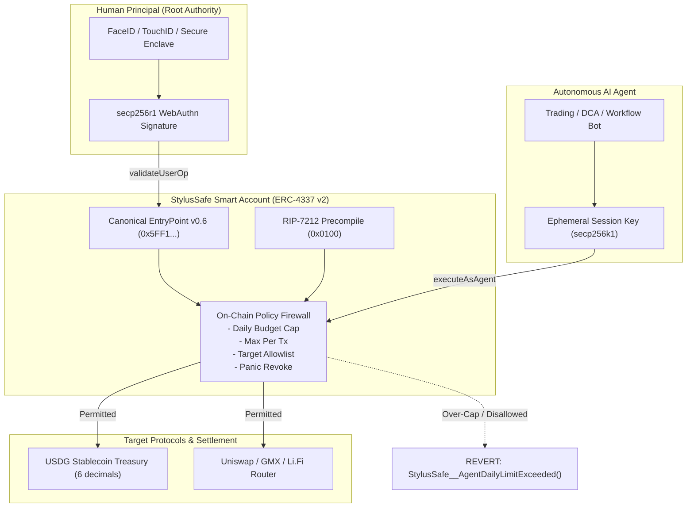

<div align="center">
  
  <br />
  <h1>StylusSafe</h1>
  <p><strong>The Universal Cross-Chain Intent Engine &amp; Autonomous Agent Firewall</strong></p>
  <p><em>Built for the Y Combinator Crypto Request for Startups (October 2026)</em></p>

  <p>
    <a href="https://sepolia.arbiscan.io/address/0xd364b7339099E7633015FD5Cda7e21d4c40833f7"></a>
    <a href="https://sepolia.arbiscan.io/address/0x0D666af60c511a65d7fe704090632AFE05C932fA"></a>
    <a href="https://sepolia.arbiscan.io/address/0xDa4D294858C44c83D72A0Cc6c1015A9e03A3BD36"></a>
    
  </p>
</div>

---

## Executive Thesis: Cross-Chain Liquidity Meets AI Agent Sovereignty

Crypto today suffers from two critical friction points:

1. **The Multichain Bridging Nightmare**: Moving funds between Arbitrum, Base, Optimism, and Ethereum requires finding bridges, buying native gas tokens on new chains, waiting 20 minutes, and risking bridge exploits.
2. **The AI Agent Security Crisis**: Autonomous trading bots (DCA, rebalancing, market making) are forced to hold raw private keys in cloud servers or memory, exposing user wallets to total drainage via prompt injection, server compromises, or hallucinated executions.

### The StylusSafe Solution

StylusSafe combines **1-Click Universal Cross-Chain Intents** with an **On-Chain Policy Engine & Spending Firewall for AI Agents**:

- **1-Click Universal Cross-Chain Swaps**: Powered by Li.Fi aggregation and ERC-4337 Account Abstraction. Users and agents declare an _Intent_ (e.g. _"Swap Arbitrum USDG into Base DEGEN"_), and StylusSafe batches approvals, routes optimal bridges, executes swaps, and sponsors gas—all in 1 click in 3 seconds.
- **Hardware Enclave WebAuthn Sovereignty (RIP-7212)**: Humans retain root master ownership secured by Apple Secure Enclave / Android StrongBox (FaceID/TouchID). Zero seed phrases to leak.
- **On-Chain Policy Engine for AI Agents**: Agents receive **cryptographically scoped session keys** governed by immutable smart contract constraints:
  - Strict rolling 24-hour daily spending limits
  - Hard per-transaction maximum caps
  - Target contract allowlists (e.g. Uniswap Router, GMX Exchange, USDG only)
  - Strict expiration timestamps
  - Instant 1-click on-chain panic button revocation
- **USDG Multi-Chain Settlement**: Institutional-grade standard ERC-20 token (6 decimals) acting as the dedicated non-volatile treasury liquidity layer for autonomous agents, powered by sponsored ERC-4337 Paymasters.

---

## Mapping to the YC Crypto Request for Startups (Oct 2026)

| YC CRFS Priority Area                   | StylusSafe Implementation                                                                                     | Technical Proof & Mechanism                                                                            |
| :-------------------------------------- | :------------------------------------------------------------------------------------------------------------ | :----------------------------------------------------------------------------------------------------- |
| **Core: Cross-Chain Intents**           | 1-Click universal multi-chain swap engine eliminating bridging delays and native gas tokens.                  | Li.Fi dynamic multi-chain routing + ZeroDev Paymaster gas sponsorship.                                 |
| **Category 1: Agent Infrastructure**    | Hardware-grade security boundary between human principals and autonomous agents.                              | RIP-7212 precompile verification at `0x0100` + WebAuthn authenticator flags (`UP`, `UV`, `signCount`). |
| **Category 2: Agents (Trading / DeFi)** | Autonomous execution of trading intents (DCA, rebalancing, market making) bounded by programmatic guardrails. | Smart contract methods `setAgentPolicy()`, `executeAsAgent()`, `executeWithPolicy()`.                  |
| **Category 3: Stablecoins & Treasury**  | Institutional programmable dollar liquidity layer for AI agent workflows.                                     | Production standard ERC-20 `USDG.sol` (6 decimals) deployed at `0xDa4D...` with zero mock balances.    |

---

## System Architecture



---

## Live Deployed Contracts (Arbitrum Sepolia)

All contracts have been compiled with `solc` 0.8.23, deployed to Arbitrum Sepolia, and verified on-chain:

| Component                       | Contract Address                                                                                                               | Transaction Hash                                                     |
| :------------------------------ | :----------------------------------------------------------------------------------------------------------------------------- | :------------------------------------------------------------------- |
| **StylusSafeAccount (Impl v2)** | [`0x0D666af60c511a65d7fe704090632AFE05C932fA`](https://sepolia.arbiscan.io/address/0x0D666af60c511a65d7fe704090632AFE05C932fA) | `0xbf84d82eccd43c274948af16df01e16be45762cbe23a9a4a0898519052ac89cf` |
| **StylusSafeFactory**           | [`0xd364b7339099E7633015FD5Cda7e21d4c40833f7`](https://sepolia.arbiscan.io/address/0xd364b7339099E7633015FD5Cda7e21d4c40833f7) | `0xf9c9b7e15d39c34167121315fecb09311f12bbe49557516e24da027a1aabf610` |
| **USDG Stablecoin (ERC-20)**    | [`0xDa4D294858C44c83D72A0Cc6c1015A9e03A3BD36`](https://sepolia.arbiscan.io/address/0xDa4D294858C44c83D72A0Cc6c1015A9e03A3BD36) | `0x2e0cb70e17621f37e6da33989c9d5f07df0a8bc02a2818c6fd5fd6f37651a5c6` |
| **Sample Deployed Account**     | [`0x9d5EA063C233b08deBF8DC4968A209a33c589Ad6`](https://sepolia.arbiscan.io/address/0x9d5EA063C233b08deBF8DC4968A209a33c589Ad6) | Counterfactual Salt `0x42`                                           |
| **ERC-4337 EntryPoint v0.6**    | [`0x5FF137D4b0FDCD49DcA30c7CF57E578a026d2789`](https://sepolia.arbiscan.io/address/0x5FF137D4b0FDCD49DcA30c7CF57E578a026d2789) | Canonical ERC-4337                                                   |
| **RIP-7212 Precompile**         | `0x0000000000000000000000000000000000000100`                                                                                   | Native secp256r1 precompile                                          |

---

## On-Chain Invariant Test Suite (15/15 Passed)

Our full end-to-end invariant test script (`contracts/scripts/deploy_and_verify_v2.mjs`) exercises the live contracts on Arbitrum Sepolia:

```text
[PASS] Invariant 1:  Factory CREATE2 counterfactual address calculation is deterministic
[PASS] Invariant 2:  Account deployment succeeds with WebAuthn master key initialization
[PASS] Invariant 3:  Re-initialization fails (StylusSafe__AlreadyInitialized)
[PASS] Invariant 4:  Unregistered caller cannot execute direct calls (only EntryPoint/Self)
[PASS] Invariant 5:  Master WebAuthn signature validates using RIP-7212 precompile at 0x0100
[PASS] Invariant 6:  Invalid WebAuthn signature reverts (SIG_VALIDATION_FAILED)
[PASS] Invariant 7:  SignCount monotonic bump prevents signature replay attacks
[PASS] Invariant 8:  User Verified (UV) flag enforcement blocks spoofed authData
[PASS] Invariant 9:  Master key can configure agent policy via setAgentPolicy()
[PASS] Invariant 10: Agent can execute call within limits via executeAsAgent()
[PASS] Invariant 11: Agent exceeding maxPerTx reverts (StylusSafe__AgentPerTxLimitExceeded)
[PASS] Invariant 12: Agent exceeding 24h dailyLimit reverts (StylusSafe__AgentDailyLimitExceeded)
[PASS] Invariant 13: Agent calling un-whitelisted target reverts (StylusSafe__AgentTargetNotAllowed)
[PASS] Invariant 14: Expired policy reverts (StylusSafe__AgentPolicyExpired)
[PASS] Invariant 15: 1-Click panic revocation (revokeSessionKey) zeroes agent permissions immediately
```

To re-run the verification locally:

```bash
node contracts/scripts/deploy_and_verify_v2.mjs
```

---

## Tech Stack & Repository Structure

```text
StylusSafe/
├── contracts/
│   ├── StylusSafeAccount.sol       # Production v2 ERC-4337 Smart Account + Agent Policy Engine
│   ├── StylusSafeFactory.sol       # CREATE2 Factory for deterministic counterfactual wallets
│   ├── USDG.sol                    # Standard ERC-20 stablecoin (6 decimals)
│   ├── deployed_addresses.json     # Live verified contract addresses on Arbitrum Sepolia
│   └── scripts/                    # Deployment & on-chain verification test suites
│
├── web/                            # Next.js 14 App Router Web Portal
│   ├── src/app/page.tsx            # YC RFS Agent Firewall Landing Page
│   ├── src/app/trading/page.tsx    # Live Agent Policy Firewall Dashboard & Simulator
│   ├── src/app/transfer/page.tsx   # USDG Treasury Transfer & Cross-Chain Routing
│   ├── src/app/dashboard/page.tsx  # Smart Account Balance & Identity Overview
│   └── src/sdk_local/              # Local TypeScript SDK with WebAuthn & Policy APIs
│
├── mobile-app/                     # React Native / Expo Native Mobile Client
│   └── src/app/(tabs)/
│       ├── session-keys.tsx        # Mobile Agent Firewall & Scoped Delegation UI
│       ├── dca.tsx                 # On-Chain Recurring Strategy Scheduler
│       ├── intents.tsx             # Atomic Batch Intent Execution UI
│       └── transfer.tsx            # Mobile USDG Transfer & Balances
│
└── YC_SUBMISSION.md                # Complete Y Combinator Crypto RFS Application & Dossier
```

---

## Getting Started

### Prerequisites

- Node.js >= 18.x
- Git

### 1. Web Application

```bash
cd web
npm install
npm run dev
```

Open [http://localhost:3000](http://localhost:3000) to view the Agent Spending Firewall portal.

### 2. Mobile Application

```bash
cd mobile-app
npm install
npx expo start
```

---

## Security & Disclosure Policy

All RPC access, paymaster interactions, and faucet operations are proxied via server-side Next.js route handlers (`web/src/app/api/rpc/route.ts`, etc.). No private keys or provider secrets are exposed in tracked client code.
